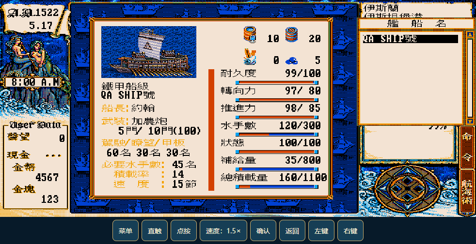
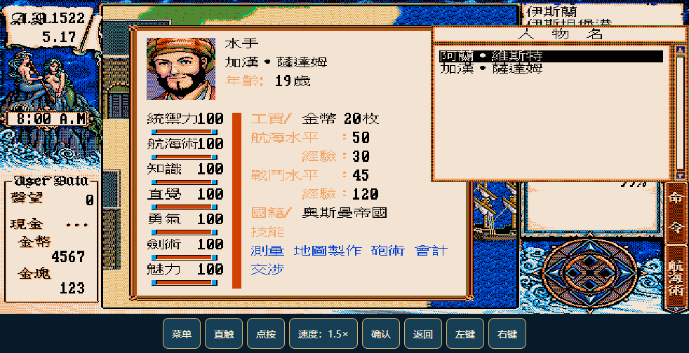

# 大航海时代2


为手机横屏游玩整理的《大航海时代Ⅱ》Android 触屏适配版。

基于 [maxleolee-eng/Uncharted-Waters-2-Android](https://github.com/maxleolee-eng/Uncharted-Waters-2-Android) 的 **v7.8**，继续改善触摸操作、移动控制、画面与速度设置，并加入适合手机使用的存档修改器。

保留原作剧情、人物、地图和内容。游戏通过 DOSBox-X / js-dos 运行，外层使用 Android WebView；不是重写游戏引擎。修改器和水粮补丁由玩家自行启用。

**当前版本：0.8 · 测试版 · Android 8.0 及以上 · 横屏**

[下载 APK](https://github.com/creamycalf/Uncharted-Waters2/releases/download/v0.8/Uncharted-Waters-2-Mobile-0.8.apk) · [版本说明与全部附件](https://github.com/creamycalf/Uncharted-Waters2/releases/tag/v0.8) · [反馈问题](https://github.com/creamycalf/Uncharted-Waters2/issues)

## 安装与更新

1. 从上方链接下载安装 APK，允许安装该来源的应用。
2. 已安装本仓库之前的适配版，可直接**覆盖安装，不要先卸载**，以保留应用内存档。
3. 启动后横屏游玩；0.7 的修改器与菜单平级，直触显示确认/返回，滑鼠显示左键/右键。

应用名称为 **大航海时代2**，包名为 `org.local.uw2mobile`。它与原作者的应用是不同安装包，可并存，但不会自动读取原应用的私有存档。首次安装的十条存档为空，不含测试存档。

当前 APK 使用固定的本地测试证书签名，属于预发布测试版本。源码仓库不包含签名私钥；自行构建会生成自己的测试证书，通常不能直接覆盖这里发布的 APK。

## 0.8 更新

游戏铺满可用屏幕，取消固定底栏；以悬浮“工具”展开菜单、修改器、速度与操作模式。移动时隐藏确认/返回，菜单或对话时显示；摇杆只在可移动场景显示，数量输入按需出现。展开工具可使用备用按键。

## 0.7.1 本地更新

首页和启动加载图铺满屏幕，以不透明背景遮住 DOSBox；进入游戏及读档重启均在就绪后撤下加载层。

## 0.7 本地更新

- 修改器移到底部。直触显示确认/返回，滑鼠显示左键/右键，两组输入语义不同。
- 新增武器、防具选择及攻击/防御数值；物品栏满时拒绝新增。
- 新增海图、130 港口和普通村落解锁，保留藏宝记录、剧情与发现奖励流程。
- 25 种船型配原版图片、基础能力和用途参考；船型替换不改变造船厂售卖条件。
- 菜单新增离线图文入门攻略。

GitHub Release 提供 0.8 安装包；本地 APK 位于 `dist/Uncharted-Waters-2-Mobile-0.8.apk`。

## 手机操作

| 功能 | 使用方式 |
| --- | --- |
| 直接触摸 | 默认“直触”模式，轻点头像、对话选项和原游戏菜单。 |
| 滑动移动 | 在移动区域滑动指定方向；达到滑动阈值后，不再将抬手误判成点击。 |
| 摇杆 | 适合人物与船只操作。城市四向，海上八向；换向时释放旧方向输入。 |
| 点按寻路 | 点城市可见道路自动移动，再次触摸可停止。**实验功能**，不支持海上自动航线或跨地图寻路。 |
| 滑鼠 | 将画面当作触摸板滑动定位，再按“左键”或“右键”；适合较小的菜单选项。 |
| 画面 | 默认铺满游戏区域；在“菜单”里切换等比显示。铺满会拉伸原画。 |
| 速度 | 点“速度”，在 **1×–3×** 间以 0.25× 调整，默认 1.5×。性能不足时调低。 |
| 数量输入 | 买卖、补给、雇佣等原游戏数量框出现时启用，提供数字、清空、最大和确认。 |
| 音乐 | 在“菜单”里开启或关闭；保留静音选择。加速可能影响音乐节奏。 |
| 存档 | “菜单 → 保存 / 读取”；也保留原游戏内菜单。 |

点击底部移动模式按钮，可在 **滑动 → 摇杆 → 点按** 之间切换。场景转场或打开面板时，会停止当前移动输入。

## 内置修改器

入口：**工具 → 修改器（与菜单平级）**。

| 分类 | 可修改内容 |
| --- | --- |
| 金钱与声望 | 金币、交易声望、海盗声望、冒险声望。 |
| 船只与水手 | 已有船只的船型、当前/最大耐久、推进、转向、水手人数与舱位、火炮数量与炮舱、货舱容量。 |
| 海员能力 | 主角及已加入海员的八项能力、航海/战斗等级、忠诚度，以及交涉、会计、炮术、制图、测量技能。 |
| 武器与地图（0.7） | 选择武器、防具并查看攻击/防御；解锁全海图、港口和普通村落。藏宝记录与奖励状态保留。 |
| 快捷填入 | 修复到耐久上限、水手补至舱位、八项能力 100、学会全部技能。仍须点击应用才会写入。 |
| 航行补丁 | 航行不耗粮食、不耗水；默认关闭，**下次启动游戏时生效**。 |

### 正确的使用顺序

1. 在游戏中**先保存当前进度**。
2. 打开修改器，选择要修改的存档，再选择船只或海员。
3. 输入目标数值。切换分类和对象会保留待修改项；切换存档或关闭面板会清除未应用的输入。
4. 点击 **“备份并应用”**。
5. 点击 **“读取记录”**，读取刚才修改的同一个记录，游戏中才会生效。

“恢复修改前备份”恢复最近一次应用前的**完整十条存档文件**，恢复后也需要读档。每次应用会更新这一份备份，并非无限历史记录。

水手、火炮和耐久有相应容量检查；降低货舱容量时，会检查已有货物和补给。换船型保留船名、材质、现有性能和舱位；原游戏再次改造或计算船只属性时，可能按船型重新计算。没有装炮的船，需要先在原游戏造船厂装炮。

原游戏内中文姓名保持原样。修改器暂以职务、等级和存档编号区分海员，以队伍顺序区分船只；ASCII 名称可以直接显示。当前不提供新建船只、强制招募剧情人物或全世界同类船模板修改，也不是完整移植 Dk2Edit。

## 实际效果

下面是测试存档在原游戏信息页的读档结果，用于核对修改器写入是否被原游戏正确读取。测试存档不会装入 APK。

| 舰船信息 | 海员信息 |
| --- | --- |
|  |  |

## 版本变化

| 版本 | 主要变化 |
| --- | --- |
| **0.7（本地）** | 独立修改器入口、按模式精简按钮、装备与地图编辑、船型图鉴、离线图文攻略。 |
| **0.6.1** | 应用名称统一为“大航海时代2”。 |
| 0.6 | 新增船只、水手与海员编辑；分类表单、容量检查、统一备份应用。 |
| 0.5 | 更换帆船与罗盘图标，支持自适应及 Android 13 主题单色图标。 |
| 0.4 | 改进方向切换；加入可调速度、铺满/等比和实验性城市点按寻路；修复加速后音乐静音问题。 |
| 0.2–0.3 | 本地页面加载修复、直接触摸、滑动/滑鼠、布局优化、金钱声望编辑与水粮补丁。 |

## 测试情况与当前限制

- 20 项 Node 测试通过，覆盖存档字段、数据范围、指定对象隔离、方向切换、寻路及布局等。
- 在桌面浏览器运行真实 DOS 引擎，检查过选人触摸、菜单、移动、音乐、存读档，以及修改后的原游戏信息页。
- 船只/海员验收使用基于中文版实际初始存档构造的测试对象；原生重新保存后修改仍保留，备份恢复通过逐字节比较。
- 0.7 装备与地图编辑通过原生重新保存验证；攻略图片加载、关闭后返回游戏和两组操作按钮切换通过。
- 0.7 APK 的 246 个资源文件路径、长度和 SHA-256 校验通过，v2/v3 签名验证通过。
- **尚未完成 Android 真机性能及全剧情验收**，不能保证所有手机、城市、人物和菜单均无问题。
- 点按寻路主要在塞维尔港验证；其他城市可能无法识别。无法寻路时可切回摇杆或滑动。
- 水粮补丁已核对程序特征和启动加载；连续海上航行的耗粮耗水对照验收仍未完成。

详见 [验证记录](docs/verification.json) 和 [中文版存档结构核验](mobile/docs/chinese-fleet-layout.md)。

反馈时请提供手机型号、Android 版本、APK 版本、操作步骤，以及截图或录像；涉及存档的问题请先备份。

## 从源码构建

目前构建脚本面向 **Windows PowerShell**，不依赖 Gradle。

需要：Git、Node.js 20+、JDK 21、Android SDK Platform 36、Build Tools 36.0.0，以及 Windows 自带的 `tar`。

```powershell
git clone https://github.com/creamycalf/Uncharted-Waters2.git
cd Uncharted-Waters2
```

自行准备上游 **v7.8** APK，放在仓库根目录，文件名必须是：

```text
Uncharted-Waters-2-Android-v7.8.apk
```

上游版本和说明见 [原项目 Releases](https://github.com/maxleolee-eng/Uncharted-Waters-2-Android/releases)。该 APK、提取的游戏资源、工具链与签名私钥均不纳入 Git 历史。

```powershell
powershell -NoProfile -ExecutionPolicy Bypass -File mobile/tools/build.ps1 `
  -SdkRoot "C:\Android\Sdk" `
  -JdkRoot "C:\Java\jdk-21"
```

也可通过 `ANDROID_HOME`（或 `ANDROID_SDK_ROOT`）及 `JAVA_HOME` 指定路径。输出为 `dist/Uncharted-Waters-2-Mobile-0.8.apk`。首次构建生成 `mobile/build/local-test.jks`；后续自行发布时应妥善保存，勿提交到仓库。

### 验证与浏览器预览

构建完成，或先运行 `mobile/tools/bootstrap.ps1` 提取测试所需的原版程序后，执行：

```powershell
node --test mobile/tests/core.test.cjs mobile/tests/frame-scheduling.test.cjs mobile/tests/mobile04.test.cjs mobile/tests/fleet.test.cjs mobile/tests/extras.test.cjs
```

浏览器预览：

```powershell
node mobile/tools/prepare.cjs
node mobile/tools/dev-server.cjs
```

打开 `http://127.0.0.1:4173`。浏览器预览不等同于 Android 真机验收。

可选自动化测试需要安装 `playwright-core` 和 Chrome；开发服务器的 `--browser` 参数启动本机测试浏览器，`mobile/tools/browser.cjs` 连接本机 CDP 9223。可用 `PLAYWRIGHT_MODULE` / `CHROME_PATH` 指定依赖和浏览器路径。原生游戏验收需通过 `UW2_TEST_SAVE` 指向自行准备的本地中文版阿兰初始存档（记录 2）。`fleet-runtime.cjs` 会替换测试浏览器中的存档，仅应在专用测试环境运行。Git 不包含游戏存档，单元测试数据由程序生成。

## 目录说明

```text
mobile/android/    Android WebView 外壳、清单和应用图标
mobile/src/        触屏、移动、寻路、修改器及界面样式
mobile/tools/      资源准备、构建、校验与本机预览工具
mobile/tests/      单元测试、浏览器验收脚本与测试数据生成器
mobile/docs/       中文版存档结构与实现范围
mobile/licenses/   修改器参考实现的许可文本
docs/              安装效果截图、验证记录和上游权利说明
```

## 来源与许可

感谢 [maxleolee-eng 的 Android 适配项目](https://github.com/maxleolee-eng/Uncharted-Waters-2-Android)、[JohanLi 的逆向研究](https://github.com/JohanLi/uncharted-waters-2-research) 和 [genishs 的存档编辑器](https://github.com/genishs/dh2-py-editor)。后两者的 MIT 许可文本保存在 `mobile/licenses/`，并随 APK 保留。[Dk2Edit 讨论](https://www.xycq.org.cn/forum/viewthread.php?page=1&tid=71167) 用于功能调研，其 Windows EXE 未嵌入本应用。

原游戏、名称、商标及游戏素材归各自权利人所有，本项目不是 KOEI 官方 Android 版本。不同来源的代码与素材适用各自许可，**不以本仓库统一授权整个 APK**。上游原始许可、第三方说明和对应 GPL 组件源码说明见 [NOTICE](NOTICE.md)；Release 同时提供上游 v7.8 的 GPL 组件源码归档。

## 封版交接

[0.8 技术交接与已知问题](docs/HANDOFF-0.8.md) · [0.8 发布说明](docs/releases/v0.8.md)
