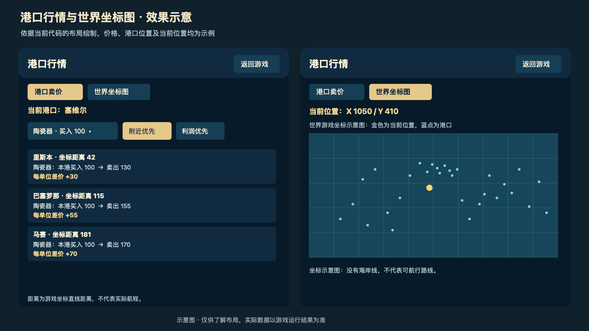
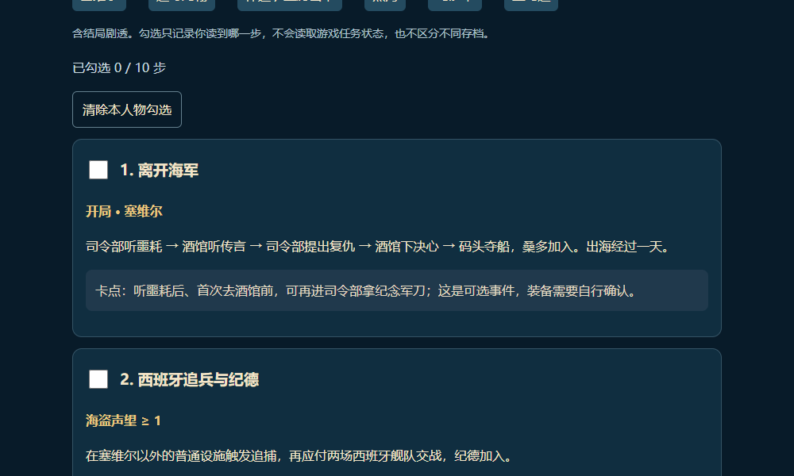
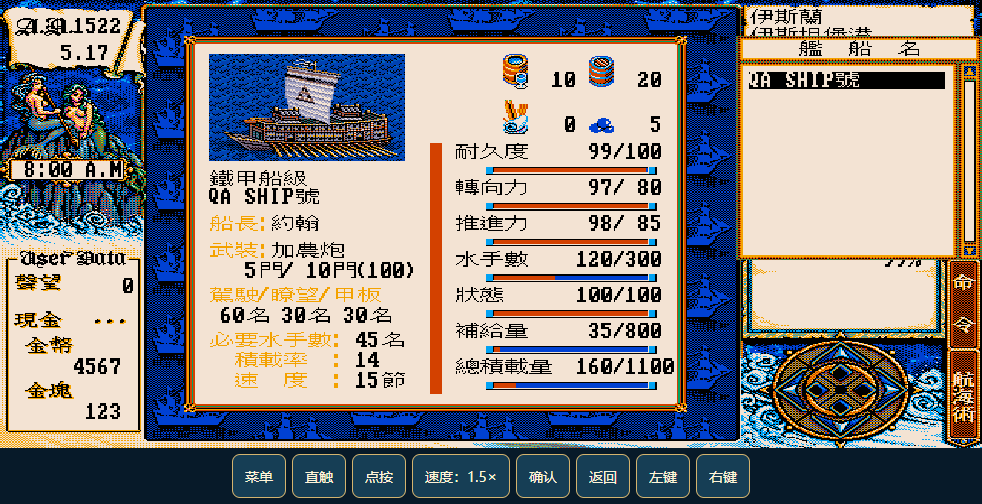
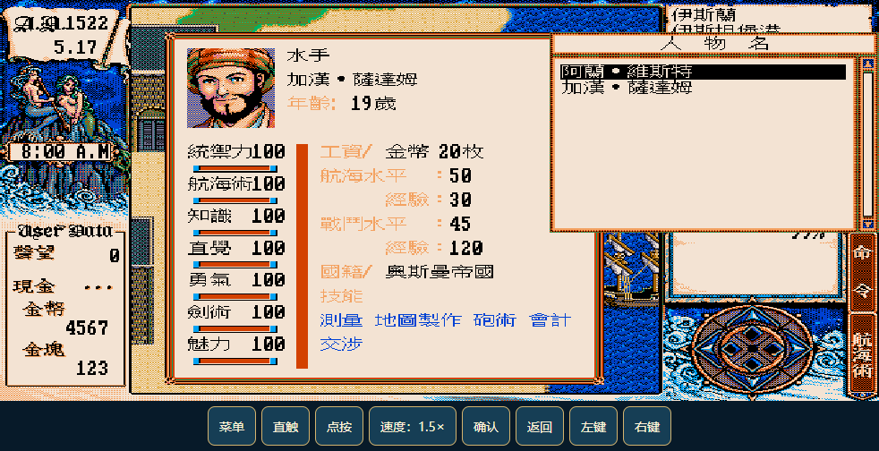

# 大航海时代2


为手机横屏游玩整理的《大航海时代Ⅱ》Android 触屏适配版。

基于 [maxleolee-eng/Uncharted-Waters-2-Android](https://github.com/maxleolee-eng/Uncharted-Waters-2-Android) 的 **v7.8**，继续改善触摸操作、移动控制、画面与速度设置，并加入适合手机使用的存档修改器。

保留原作剧情、人物、地图和内容。游戏通过 DOSBox-X / js-dos 运行，外层使用 Android WebView；不是重写游戏引擎。修改器和水粮补丁由玩家自行启用。

0.9.16 本地测试版在键盘/手柄控制基础上加入港口行情、海图缩放与存档转移。行情支持商品筛选、港口搜索、利润/距离排序及与海图联动；存档可校验后导入、导出或通过 Android 系统分享面板发送，文件名带本地时间并避免同秒覆盖。海图已在 Android API 37 模拟器确认显示、拖动和 2× 缩放；0.9.16 的系统分享、123 云盘接收及最新行情手柄导航仍待目标设备验收。此前键盘/手柄和计算器焦点操作已在 iPlay 50 Mini 上验证。本项目是 Android APK，需运行在 Android 设备或模拟器上。

**公开测试版：0.8.2 · Android 8.0 及以上 · 横屏**
**本地测试构建：0.9.16-input-test**（versionCode 29；键盘、手柄、港口行情/海图、存档转移与系统分享）

[下载 APK](https://github.com/creamycalf/Uncharted-Waters2/releases/download/v0.8.2/Uncharted-Waters-2-Mobile-0.8.2.apk) · [版本说明与全部附件](https://github.com/creamycalf/Uncharted-Waters2/releases/tag/v0.8.2) · [反馈问题](https://github.com/creamycalf/Uncharted-Waters2/issues)

## 安装与更新

1. 从上方链接下载安装 APK，允许安装该来源的应用。
2. 已安装本仓库之前的适配版，可直接**覆盖安装，不要先卸载**，以保留应用内存档。
3. 启动后横屏游玩；展开“工具”后可看到平级的菜单、修改器、攻略；移动和对话按场景显示操作按钮。

公开版应用名称为 **大航海时代2**，包名为 `org.local.uw2mobile`。本地输入测试构建使用独立包名 `org.local.uw2mobile.inputtest`，可与公开版并存；两者的游戏记录互不共享。首次启动的记录为空，不含测试存档。

当前 APK 使用固定的本地测试证书签名，属于预发布测试版本。源码仓库不包含签名私钥；自行构建会生成自己的测试证书，通常不能直接覆盖这里发布的 APK。

## 0.9.16-input-test 本地输入、行情与存档功能

- 键盘：方向键或 WASD 移动；Enter/空格确认；Escape/Backspace 返回；M 展开工具；F1 打开游戏菜单。首次启动菜单自动聚焦到可用选项；启动菜单和存档列表可用方向键移动焦点、Enter/空格选择，Escape/Backspace 关闭存档列表。工具、菜单或修改器打开时，方向键循环移动控件焦点。
- 手柄：十字键或左摇杆移动；A 确认；B 返回；X/Y 左键/右键；Start 展开工具；Select 打开菜单。右摇杆移动鼠标指针。模拟城市四向、海上八向输入，并使用摇杆死区。
- 肩键快捷操作：LB/L1=情报，LT/L2=经营，RB/R1=命令，RT/R2=航海术。扳机按钮与模拟扳机轴均受支持；按下时切换游戏右侧对应标签。四组映射已在 iPlay 50 Mini 上实机验证。
- 手柄：启动菜单和存档列表支持十字键/左摇杆移动焦点、A 确认、B 返回；当前选项带醒目的橙色焦点框。存档选择框会优先聚焦可用记录，空记录不可选。
- 数量输入框出现时，焦点框直接标在游戏画面中的原生计算器上。修正后的四排五列坐标已在 iPlay 50 Mini 确认；方向键/十字键逐格移动并支持长按重复，Enter/A 点击高亮按键，实体数字键、触摸和鼠标仍可直接输入。
- 港口操作画面展开“工具”后可打开“行情”：支持本港可购商品切换、简繁中文港口搜索、距离/利润排序、列表与坐标图联动，并显示最多 12 个目的港。报价从运行中的游戏状态只读计算，不会自动交易、推进时间或写入存档；不计议价、航程成本和未来供需变化。计算逻辑与数据来自上游 v8.9 GPL 组件，见 [NOTICE](NOTICE.md)。实际港口行情仍需在目标设备验收。
- “行情/地图”使用校验过的 v8.9 世界投影叠加港口和当前位置，支持 1×/2×/4× 缩放及拖动；距离为游戏坐标直线距离，并非海上航程。布局示意见下图，数值为示例。



- “工具 → 菜单 → 存档转移”支持十条记录快照的导入/导出；导入前会校验游戏版本、记录和摘要，保存独立备份，确认后替换记录，并可在失败时回滚。成功导入后需读取记录才能继续。
- “分享至123云盘”通过 Android 系统分享面板交给用户选择的应用；上传、登录和目录选择由用户在云盘客户端完成，应用不会自动联网或保存云盘凭证。导出/分享文件以设备本地日期时间命名，同秒重复会追加序号，避免覆盖。
- 切换应用、失去窗口焦点或移除手柄时释放按住的方向。文本框获得焦点时，键盘输入交还给 WebView。
- 生成测试 APK：`dist/Uncharted-Waters-2-Mobile-0.9.16-input-test.apk`，包名 `org.local.uw2mobile.inputtest`，versionCode 29。它与公开版及其存档分离；APK、游戏素材、存档和签名密钥不纳入仓库。
- 41 项 Node 检查及 v2/v3 APK 签名验证已记录通过；海图已在 Android API 37 模拟器确认显示和 2× 缩放。0.9.16 系统分享/123 云盘接收及最新行情手柄导航尚未实机验收。详情见 [当前交接](docs/handoff.md)。

## 0.8.2 更新

展开“工具”后直接点“攻略”，与“菜单”“修改器”平级。

## 0.8.1 更新

攻略首页改为六位主角：约翰、卡特琳娜、奥托、恩斯特、皮耶德、阿兰。新增 57 个主线关键步骤，逐项显示触发条件、前往地点和卡点；原版头像、行程示意、当前人物搜索、手动阅读勾选均可离线使用。旧通用图文说明保留在独立入口。

资料与版本差异见 [人物攻略来源](mobile/docs/guide-sources.md)。尚未完成六个人物在本 APK 的逐项通关验收。GitHub Release 提供 0.8.2 安装包，本地成品为 `dist/Uncharted-Waters-2-Mobile-0.8.2.apk`。

## 0.8 更新

游戏铺满可用屏幕，取消固定底栏；以悬浮“工具”展开菜单、修改器、速度与操作模式。移动时隐藏确认/返回，菜单或对话时显示；摇杆只在可移动场景显示。展开工具可使用备用按键。

## 0.7.1 本地更新

首页和启动加载图铺满屏幕，以不透明背景遮住 DOSBox；进入游戏及读档重启均在就绪后撤下加载层。

## 0.7 本地更新

- 修改器移到底部。直触显示确认/返回，滑鼠显示左键/右键，两组输入语义不同。
- 新增武器、防具选择及攻击/防御数值；物品栏满时拒绝新增。
- 新增海图、130 港口和普通村落解锁，保留藏宝记录、剧情与发现奖励流程。
- 25 种船型配原版图片、基础能力和用途参考；船型替换不改变造船厂售卖条件。
- 菜单新增离线图文入门攻略。

最新安装包见页面顶部的 0.8.2 下载链接。

## 手机操作

| 功能 | 使用方式 |
| --- | --- |
| 直接触摸 | 默认“直触”模式，轻点头像、对话选项和原游戏菜单。 |
| 滑动移动 | 在移动区域滑动指定方向；达到滑动阈值后，不再将抬手误判成点击。 |
| 摇杆 | 适合人物与船只操作。城市四向，海上八向；换向时释放旧方向输入。 |
| 点按寻路 | 点城市可见道路自动移动，再次触摸可停止。**实验功能**，不支持海上自动航线或跨地图寻路。 |
| 滑鼠 | 将画面当作触摸板滑动定位，再按“左键”或“右键”；适合较小的菜单选项。 |
| 画面 | 默认铺满游戏区域；在“菜单”里切换等比显示。铺满会拉伸原画。 |
| 速度 | 点“速度”，在 **1×–3×** 间以 0.25× 调整，默认 1.5×。性能不足时调低。 |
| 数量输入 | 原游戏计算器可直接触摸；键盘/手柄方向键移动画面内焦点，Enter/A 点选，实体数字键直接输入。 |
| 音乐 | 在“菜单”里开启或关闭；保留静音选择。加速可能影响音乐节奏。 |
| 存档 | “菜单 → 保存 / 读取”；也保留原游戏内菜单。 |

点击底部移动模式按钮，可在 **滑动 → 摇杆 → 点按** 之间切换。场景转场或打开面板时，会停止当前移动输入。

## 内置修改器

入口：**工具 → 修改器（与菜单平级）**。

| 分类 | 可修改内容 |
| --- | --- |
| 金钱与声望 | 金币、交易声望、海盗声望、冒险声望。 |
| 船只与水手 | 已有船只的船型、当前/最大耐久、推进、转向、水手人数与舱位、火炮数量与炮舱、货舱容量。 |
| 海员能力 | 主角及已加入海员的八项能力、航海/战斗等级、忠诚度，以及交涉、会计、炮术、制图、测量技能。 |
| 武器与地图（0.7） | 选择武器、防具并查看攻击/防御；解锁全海图、港口和普通村落。藏宝记录与奖励状态保留。 |
| 快捷填入 | 修复到耐久上限、水手补至舱位、八项能力 100、学会全部技能。仍须点击应用才会写入。 |
| 航行补丁 | 航行不耗粮食、不耗水；默认关闭，**下次启动游戏时生效**。 |

### 正确的使用顺序

1. 在游戏中**先保存当前进度**。
2. 打开修改器，选择要修改的存档，再选择船只或海员。
3. 输入目标数值。切换分类和对象会保留待修改项；切换存档或关闭面板会清除未应用的输入。
4. 点击 **“备份并应用”**。
5. 点击 **“读取记录”**，读取刚才修改的同一个记录，游戏中才会生效。

“恢复修改前备份”恢复最近一次应用前的**完整十条存档文件**，恢复后也需要读档。每次应用会更新这一份备份，并非无限历史记录。

水手、火炮和耐久有相应容量检查；降低货舱容量时，会检查已有货物和补给。换船型保留船名、材质、现有性能和舱位；原游戏再次改造或计算船只属性时，可能按船型重新计算。没有装炮的船，需要先在原游戏造船厂装炮。

原游戏内中文姓名保持原样。修改器暂以职务、等级和存档编号区分海员，以队伍顺序区分船只；ASCII 名称可以直接显示。当前不提供新建船只、强制招募剧情人物或全世界同类船模板修改，也不是完整移植 Dk2Edit。

## 人物攻略

在“工具”第一层点击“攻略”，选择人物查看主线。阅读勾选只记录查阅进度，不会修改游戏任务。

| 六位主角入口 | 条件与卡关排查 |
| --- | --- |
|  |  |

## 实际效果

下面是测试存档在原游戏信息页的读档结果，用于核对修改器写入是否被原游戏正确读取。测试存档不会装入 APK。

| 舰船信息 | 海员信息 |
| --- | --- |
|  |  |

## 版本变化

| 版本 | 主要变化 |
| --- | --- |
| **0.7（本地）** | 独立修改器入口、按模式精简按钮、装备与地图编辑、船型图鉴、离线图文攻略。 |
| **0.6.1** | 应用名称统一为“大航海时代2”。 |
| 0.6 | 新增船只、水手与海员编辑；分类表单、容量检查、统一备份应用。 |
| 0.5 | 更换帆船与罗盘图标，支持自适应及 Android 13 主题单色图标。 |
| 0.4 | 改进方向切换；加入可调速度、铺满/等比和实验性城市点按寻路；修复加速后音乐静音问题。 |
| 0.2–0.3 | 本地页面加载修复、直接触摸、滑动/滑鼠、布局优化、金钱声望编辑与水粮补丁。 |

## 测试情况与当前限制

- 20 项 Node 测试通过，覆盖存档字段、数据范围、指定对象隔离、方向切换、寻路及布局等。
- 在桌面浏览器运行真实 DOS 引擎，检查过选人触摸、菜单、移动、音乐、存读档，以及修改后的原游戏信息页。
- 船只/海员验收使用基于中文版实际初始存档构造的测试对象；原生重新保存后修改仍保留，备份恢复通过逐字节比较。
- 0.7 装备与地图编辑通过原生重新保存验证；攻略图片加载、关闭后返回游戏和两组操作按钮切换通过。
- 0.7 APK 的 246 个资源文件路径、长度和 SHA-256 校验通过，v2/v3 签名验证通过。
- **尚未完成 Android 真机性能及全剧情验收**，不能保证所有手机、城市、人物和菜单均无问题。
- 点按寻路主要在塞维尔港验证；其他城市可能无法识别。无法寻路时可切回摇杆或滑动。
- 水粮补丁已核对程序特征和启动加载；连续海上航行的耗粮耗水对照验收仍未完成。

详见 [验证记录](docs/verification.json) 和 [中文版存档结构核验](mobile/docs/chinese-fleet-layout.md)。

反馈时请提供手机型号、Android 版本、APK 版本、操作步骤，以及截图或录像；涉及存档的问题请先备份。

## 从源码构建

Windows 使用 PowerShell 构建；macOS 可运行 `bash mobile/tools/build-macos.sh`，同样不依赖 Gradle。

需要：Git、Node.js 20+、JDK 21+、Android SDK Platform 36+、Build Tools 36.0.0。macOS 构建使用系统 `unzip` 和 Python 3；Windows 构建另需 PowerShell 与系统 `tar`。

```powershell
git clone https://github.com/creamycalf/Uncharted-Waters2.git
cd Uncharted-Waters2
```

自行准备上游 **v7.8** APK，放在仓库根目录，文件名必须是：

```text
Uncharted-Waters-2-Android-v7.8.apk
```

上游版本和说明见 [原项目 Releases](https://github.com/maxleolee-eng/Uncharted-Waters-2-Android/releases)。该 APK、提取的游戏资源、工具链与签名私钥均不纳入 Git 历史。

```powershell
powershell -NoProfile -ExecutionPolicy Bypass -File mobile/tools/build.ps1 `
  -SdkRoot "C:\Android\Sdk" `
  -JdkRoot "C:\Java\jdk-21"
```

也可通过 `ANDROID_HOME`（或 `ANDROID_SDK_ROOT`）及 `JAVA_HOME` 指定路径。输出为 `dist/Uncharted-Waters-2-Mobile-0.8.2.apk`。首次构建生成 `mobile/build/local-test.jks`；后续自行发布时应妥善保存，勿提交到仓库。

### 验证与浏览器预览

构建完成，或先运行 `mobile/tools/bootstrap.ps1` 提取测试所需的原版程序后，执行：

```powershell
node --test mobile/tests/core.test.cjs mobile/tests/frame-scheduling.test.cjs mobile/tests/mobile04.test.cjs mobile/tests/fleet.test.cjs mobile/tests/extras.test.cjs
```

浏览器预览：

```powershell
node mobile/tools/prepare.cjs
node mobile/tools/dev-server.cjs
```

打开 `http://127.0.0.1:4173`。浏览器预览不等同于 Android 真机验收。

可选自动化测试需要安装 `playwright-core` 和 Chrome；开发服务器的 `--browser` 参数启动本机测试浏览器，`mobile/tools/browser.cjs` 连接本机 CDP 9223。可用 `PLAYWRIGHT_MODULE` / `CHROME_PATH` 指定依赖和浏览器路径。原生游戏验收需通过 `UW2_TEST_SAVE` 指向自行准备的本地中文版阿兰初始存档（记录 2）。`fleet-runtime.cjs` 会替换测试浏览器中的存档，仅应在专用测试环境运行。Git 不包含游戏存档，单元测试数据由程序生成。

## 目录说明

```text
mobile/android/    Android WebView 外壳、清单和应用图标
mobile/src/        触屏、移动、寻路、修改器及界面样式
mobile/tools/      资源准备、构建、校验与本机预览工具
mobile/tests/      单元测试、浏览器验收脚本与测试数据生成器
mobile/docs/       中文版存档结构与实现范围
mobile/licenses/   修改器参考实现的许可文本
docs/              安装效果截图、验证记录和上游权利说明
```

## 来源、致谢与许可

特别感谢 [maxleolee-eng](https://github.com/maxleolee-eng/Uncharted-Waters-2-Android) 创建原始 Android 触屏适配项目，也感谢 [Creamy Calf](https://github.com/creamycalf/Uncharted-Waters2) 在其基础上继续魔改、扩展和维护。本地硬件输入分支在前述工作基础上增加键盘与手柄控制。也感谢 [JohanLi 的逆向研究](https://github.com/JohanLi/uncharted-waters-2-research) 和 [genishs 的存档编辑器](https://github.com/genishs/dh2-py-editor)；两者的 MIT 许可文本保存在 `mobile/licenses/`，并随 APK 保留。[Dk2Edit 讨论](https://www.xycq.org.cn/forum/viewthread.php?page=1&tid=71167) 用于功能调研，其 Windows EXE 未嵌入本应用。

原游戏、名称、商标及游戏素材归各自权利人所有，本项目不是 KOEI 官方 Android 版本。不同来源的代码与素材适用各自许可，**不以本仓库统一授权整个 APK**。上游原始许可、第三方说明和对应 GPL 组件源码说明见 [NOTICE](NOTICE.md)；Release 同时提供上游 v7.8 的 GPL 组件源码归档。

## 封版交接

[当前键盘/手柄测试构建交接](docs/handoff.md) · [0.8.2 技术交接与已知问题](docs/HANDOFF-0.8.2.md) · [0.8.2 发布说明](docs/releases/v0.8.2.md)


## 0.9.10 港口卖价与世界坐标图

“工具 → 行情/地图”提供本港可购商品的其他港口卖价，可按坐标距离或单位差价排序；展示前 12 个目的港。世界坐标图使用运行中游戏内存里的 130 个港口坐标及玩家坐标，城市和海上可打开。图为坐标示意，尚未校准海岸线；坐标直线距离不是实际海上航程。基于 v7.8 中文版和已验证布局，真实游戏及设备验收待完成。构建依赖、基础 APK 和保存规则沿用本交接既有说明。


### 0.9.11 本地行情联动

港口行情加入本港全部可购商品切换、简繁中文港口名称搜索、附近/利润排序及列表与坐标图选择联动。显示少量附近港口名及选中港口信息；图仍为坐标示意，海岸线投影尚未校准，距离不等同实际航程。APK 输出 `dist/Uncharted-Waters-2-Mobile-0.9.11-input-test.apk`，versionCode 24；保留原始 v8.9 港口表，另以 ICU Traditional-Simplified 生成简体名称表。模拟行情交互检查和现有 20 项测试通过；没有可用的 Android 模拟器和 iPlay 真机，实际行情与手柄仍需验证。构建依赖与存档保护沿用本文件既有说明。


### 0.9.12 航海图与缩放

本机 Android 测试版使用用户自行提供的上游 v8.9 APK 中的 `world-projection.json` 和 v7.8 基础 APK 中同哈希的世界海图底图，按上游网格插值把港口及当前位置叠上海岸线。港口圆点缩小但保留较大触摸范围；默认只显示当前及选中港口名。地图支持 1×、2×、4× 按钮缩放及拖动/滚动，距离仍为游戏坐标直线距离。

macOS 构建需准备既有 v7.8 基础 APK，并设 `UW2_V89_APK` 指向用户自行准备的 v8.9 APK 后运行 `bash mobile/tools/build-macos.sh`；构建脚本校验 APK、投影及底图哈希，不提交 APK、投影资源、游戏文件或存档。不设置该变量时显示坐标网格，Windows 构建未增加 v8.9 投影导入步骤。Android API 37 模拟器中已验证里斯本海图显示及 2× 放大，用户确认可拖动；4×、实体平板触摸和手柄操作仍待验证。


### 0.9.13 存档转移

港口或自由航海主画面中，先保存游戏，再通过“工具 → 菜单 → 存档转移”导出或导入。两个设备都应安装同一兼容测试版。Android 系统文件选择器用于选择保存位置和待导入文件；需要使用双方可访问的云盘或手动传输文件，应用本身不会自动联网同步。模拟器里的 Downloads 属于虚拟设备，需要通过 Android Studio Device Explorer、adb 或已安装的云盘应用传出；不要假定它等于 Mac 的 Downloads。

导出的 `.uw2save.json` 包含整份十条记录、已校验的 v7.8 MAIN 版本标识和 SHA-256 摘要。导入前校验长度、游戏版本、有效记录及文件摘要，并展示源/目标记录号；确认后保存一份独立于修改器的本机导入前备份。导入会替换全部十条记录；成功后必须读取一条导入记录才能继续。取消读取会返回保护面板。可恢复最近一次导入前备份；备份保存在应用本地，卸载或清除数据时也会被删除。

构建：在项目根目录准备已核验 v7.8 APK 和可选 v8.9 投影 APK，运行 `UW2_V89_APK=<v8.9 APK路径> bash mobile/tools/build-macos.sh`；产物 `dist/Uncharted-Waters-2-Mobile-0.9.13-input-test.apk`，包名 `org.local.uw2mobile.inputtest`，versionCode 26。签名密钥、用户存档、APK 和游戏资源不进入 Git。编码、拒绝损坏文件、导入确认、独立备份、回滚、恢复和取消读取采用合成数据检查；Android 文件选择器及两台真实设备迁移仍需实测。

## 0.9.14 本地行情操作

行情/地图打开后聚焦最近使用的比较港口或首条结果。手柄上下浏览当前区域，左右在筛选、比较列表、地图缩放间切换；A 选择，B 返回游戏，按住方向可连续移动。地图港口仍可触摸点选。2× / 4× 缩放倍率保存在本机，下次打开或重启应用后沿用；清除应用数据会重置。测试 APK 为 `dist/Uncharted-Waters-2-Mobile-0.9.14-input-test.apk`。手柄与倍率记忆尚待 iPlay 实机验收。

## 0.9.15 分享存档

在港口或航海主画面先正常保存，再打开“工具 → 菜单 → 存档转移 → 分享至123云盘”。安卓系统分享面板中选择 123 云盘，后续登录、选目录与上传由用户在云盘完成。分享文件为经过版本及摘要校验的十条记录快照；打开分享面板不代表上传成功。若 123 云盘没有出现在分享面板中，可先用“导出存档”保存到本机，再在云盘客户端手动上传。Android 系统分享及 123 云盘接收能力仍待实际设备验证。

## 0.9.16 存档文件名

“分享至123云盘”和“导出存档”默认使用设备本地日期时间命名，例如 `UW2-2026-11-14_18-30-22.uw2save.json`。同一秒内重复分享会附加短序号避免覆盖。存档格式和手动上传流程不变；系统分享面板及云盘显示效果仍待安卓设备验证。
